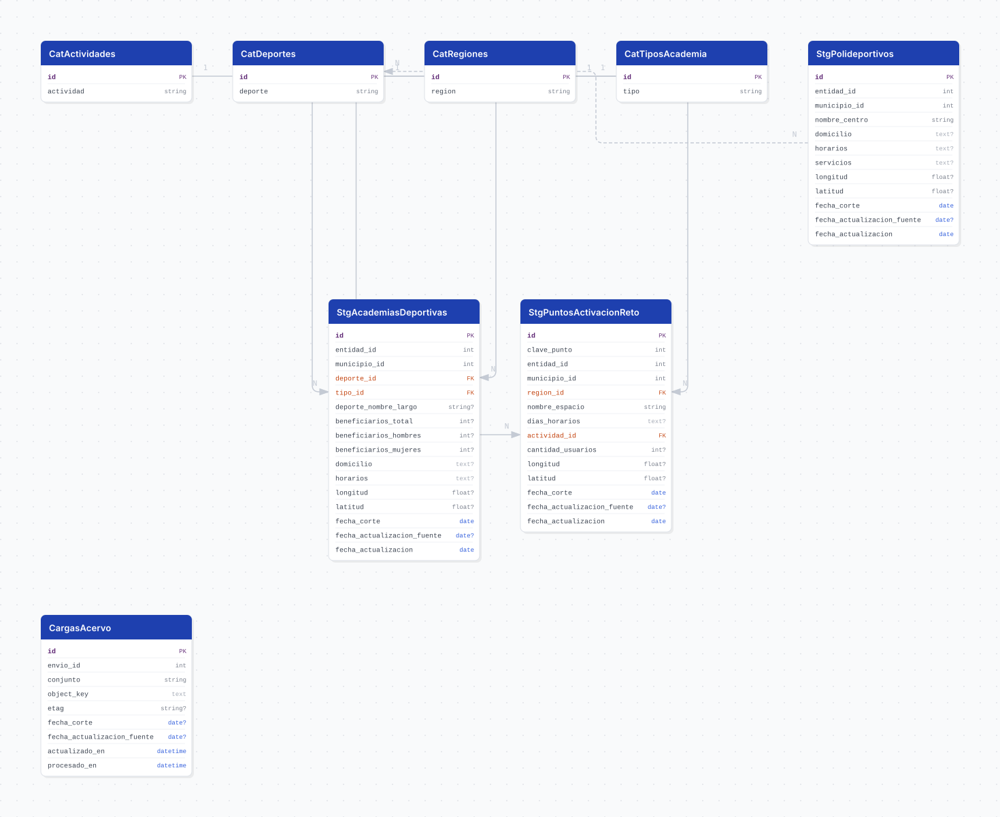

# code

> Pipeline ETL para tres conjuntos del Consejo Estatal para el Fomento Deportivo (CODE) que llegan por el formulario de datasets del SIEEJ: puntos de activación del programa Reto, Academias deportivas (Espacios para la Paz) y Polideportivos.

---

## Descripción general

Como `secretaria_educacion`, este pipeline se organiza por **dependencia**: CODE sube un archivo a Acervo mediante el formulario del SIEEJ y el pipeline lo descubre, lo transforma y lo carga.

CODE entrega los tres conjuntos en un mismo envío. Cada uno se procesa de forma independiente: el extract elige la carga más reciente **de cada conjunto**, no la más reciente del envío.

| Conjunto | Campo del formulario | Archivo |
|---|---|---|
| Puntos de activación del programa Reto, Reactivación para Todas y Todos | metodología | ZIP con xlsx (hojas `base` y `cat_actividad`) |
| Academias deportivas, Espacios para la Paz | `carga_de_datos` | ZIP con gpkg y CSV de catálogos |
| Polideportivos | `carga_de_datos` | ZIP con gpkg y CSV de catálogo |

El conjunto Reto describe los espacios donde se realizan actividades físicas del programa Reto: región, municipio, nombre del espacio, días y horarios, actividad, cantidad de usuarios y ubicación geográfica. La primera carga trae 112 puntos en 52 municipios, con corte al `2026-07-01`.

El prefijo del formulario concentra las cargas de **todas** las dependencias, así que cada una es un pipeline distinto y este filtra por el nombre de la suya.

## Fuente general

Acervo, el almacenamiento de objetos del IIEG, con API compatible con S3.

## Fuente específica

```shell
ACERVO_FORM_PREFIX=<prefijo del formulario dentro del bucket>
ACERVO_BUCKET=sieej
```

Ambos se configuran en `core/acervo/.env`, no en el `.env` de este pipeline. Ver [`core/acervo/README.md`](../../acervo/README.md) para el detalle del acceso.

## Características de los datos

| Característica | Valor |
|---|---|
| Última fecha disponible | `2026-07-01` |
| Frecuencia de actualización | Por confirmar con CODE (el DAG corre mensual) |
| Desagregación | Punto de activación (espacio), con municipio y región |
| Cobertura | 52 municipios de Jalisco en el primer corte |
| ¿Tiene update? | Sí |
| Update | Automático (`0 12 5 * *`) |
| Estrategia de carga | Reemplazo completo por conjunto: `delete` de todas las filas de la tabla + `bulk_insert`, en una sola transacción |

CODE entrega el conjunto completo en cada envío, así que cada carga reemplaza la anterior. No se guarda historia por corte y una fecha de corte corregida no deja filas duplicadas.

## Diagrama de entidad relación



## Diccionario de variables

### stg_puntos_activacion_reto

| variable | descripción |
|---|---|
| `clave_punto` | Identificador del punto en el archivo de origen (`id`). Tiene huecos y no se garantiza estable entre cortes |
| `entidad_id` | Clave de la entidad. Siempre 14 (Jalisco). Referencia lógica a `cvegeo_states.cve_ent` |
| `municipio_id` | Clave del municipio (`clave_agem` del origen, sin relleno de ceros). Referencia lógica a `cvegeo_municipalities.cve_mun`, sin FK |
| `region_id` | Región del estado, en `cat_regiones` |
| `nombre_espacio` | Nombre del espacio donde se realiza la actividad |
| `dias_horarios` | Días y horarios en texto libre, tal como los captura CODE. No se interpreta |
| `actividad_id` | Actividad que se realiza, en `cat_actividades`. Nula cuando el origen no la reporta |
| `cantidad_usuarios` | Cantidad de usuarios reportada. Ver la nota sobre su interpretación |
| `longitud`, `latitud` | Ubicación en grados decimales (EPSG:4326), columnas `x` e `y` del origen. Nulas si el origen no las trae |
| `fecha_corte` | Fecha a la que corresponden los datos, tomada de la columna `fecha` del archivo |
| `fecha_actualizacion_fuente` | Fecha del envío en el formulario (`actualizado_en`) |
| `fecha_actualizacion` | Fecha en que el ETL cargó el registro |

Restricción única: `(fecha_corte, municipio_id, nombre_espacio)`.

### stg_academias_deportivas

Una fila por academia, deporte y corte. Sin restricción única: el origen repite domicilio para varios deportes.

| variable | descripción |
|---|---|
| `entidad_id` | Siempre 14 (Jalisco) |
| `municipio_id` | `cve_mun` del origen, sin ceros a la izquierda. Referencia lógica a `cvegeo_municipalities.cve_mun` |
| `deporte_id` | Deporte, en `cat_deportes`. Se resuelve **por nombre** (ver notas) |
| `tipo_id` | Tipo de academia, en `cat_tipos_academia`. Se resuelve por nombre |
| `deporte_nombre_largo` | Nombre largo con que CODE captura la academia o disciplina, tal como viene |
| `beneficiarios_total`, `beneficiarios_hombres`, `beneficiarios_mujeres` | Beneficiarios reportados. Nulos si el origen no los trae; el total no siempre iguala hombres más mujeres |
| `domicilio`, `horarios` | Texto libre, sin interpretar |
| `longitud`, `latitud` | EPSG:4326, derivadas de la geometría del origen |
| `fecha_corte` | Columna `fecha` del archivo (dd/mm/aaaa) |
| `fecha_actualizacion_fuente`, `fecha_actualizacion` | Igual que en Reto |

### stg_polideportivos

Una fila por centro y corte. Restricción única: `(fecha_corte, municipio_id, nombre_centro)`.

| variable | descripción |
|---|---|
| `entidad_id` | `clave_entidad` del origen |
| `municipio_id` | `cve_mun` del origen, sin ceros a la izquierda |
| `nombre_centro`, `domicilio`, `horarios` | Texto del origen |
| `servicios` | Descripción libre de servicios y disciplinas. Se conserva como texto, no se normaliza |
| `longitud`, `latitud` | EPSG:4326, derivadas de la geometría |
| `fecha_corte`, `fecha_actualizacion_fuente`, `fecha_actualizacion` | Igual que en Academias |

### polideportivo_deportes

Tabla puente. `deportes` del origen es una lista de ids de `cat_deportes` separados por coma (por ejemplo `19,22,23,4`) y aquí queda una fila por polideportivo y deporte. Llave primaria `(polideportivo_id, deporte_id)`; se borra en cascada al recargar el corte.

### cargas_acervo

Control de envíos procesados: da el watermark del incremental.

| variable | descripción |
|---|---|
| `envio_id` | Identificador del envío en el formulario |
| `conjunto` | Nombre del conjunto tal como lo capturó la dependencia |
| `object_key` | Ruta del archivo dentro del bucket |
| `etag` | MD5 del contenido. Si coincide con la carga anterior, el archivo no cambió. No es MD5 en subidas multiparte |
| `actualizado_en` | Última modificación del envío. Es el watermark del incremental |
| `procesado_en` | Momento en que el ETL procesó el envío |

### Catálogos

| tabla | contenido |
|---|---|
| `cat_actividades` | 21 actividades. El id es el código del origen (hoja `cat_actividad`) |
| `cat_regiones` | 13 regiones del estado, ya normalizadas. El id es generado |
| `cat_deportes` | 40 deportes, compartido por Academias y Polideportivos. El id es el código del origen |
| `cat_tipos_academia` | Tipos de academia. El id es generado: el origen no lista `Semillero Rojiblanco` y le asigna el código de `Regular` |

## Migraciones

| migración | descripción |
|---|---|
| `V1__foreign_tables.sql` | Servidor FDW y foreign tables `cvegeo_states` y `cvegeo_municipalities` |
| `V2__catalogs_code.sql` | Los 2 catálogos |
| `V3__tables_code.sql` | La tabla de hechos y la de control |
| `V4__views_code.sql` | La vista `vw_puntos_activacion_reto` |
| `V5__comments_code.sql` | `COMMENT ON` de todas las tablas, la vista y sus columnas |
| `V6__materialized_view_reto_code_geo.sql` | Vista materializada geográfica de puntos de activación Reto |
| `V7__tables_academias_polideportivos_code.sql` | Catálogos `cat_deportes` y `cat_tipos_academia`, tablas `stg_academias_deportivas`, `stg_polideportivos` y la puente |
| `V8__views_academias_polideportivos_code.sql` | Vistas `vw_academias_deportivas`, `vw_polideportivos` y `vw_polideportivo_deportes` |
| `V9__comments_academias_polideportivos_code.sql` | `COMMENT ON` de las tablas, vistas y columnas nuevas |

## Vistas

| vista | alcance |
|---|---|
| `vw_puntos_activacion_reto` | Puntos con región y actividad resueltas; entidad y municipio desde cvegeo; `longitud` y `latitud` directas de la tabla |
| `vw_academias_deportivas` | Academias con deporte y tipo resueltos; entidad y municipio desde cvegeo |
| `vw_polideportivos` | Polideportivos con los deportes agregados en texto |
| `vw_polideportivo_deportes` | Una fila por polideportivo y deporte |
| `vm_reto_code_geo` | Puntos de activación Reto con actividad, atributos geográficos y geometría puntual EPSG:6368 |

## Variables de entorno

| variable | descripción |
|---|---|
| `DB_USER`, `DB_PASSWORD`, `DB_HOST`, `DB_PORT`, `DB_NAME` | Conexión a la base del pipeline |
| `DEPENDENCIA` | Nombre de la dependencia a filtrar en el formulario |

Las credenciales de Acervo viven en `core/acervo/.env`. Los placeholders FDW del `flyway.conf` no se declaran aquí: la receta `just flyway-config` los resuelve desde `migrations/cvegeo/.env`.

## Notas metodológicas

### Extract

Pide a `list_uploads` los envíos de la dependencia una vez por campo del formulario (Reto en el de metodología, los otros dos en `carga_de_datos`) y asigna cada carga a su conjunto por el **nombre del conjunto** (`nombre_del_conjunto_de_datos` dentro de `conunto_datos[i]`, expuesto como `Upload.dataset_name`), con comparación por prefijo sin acentos. No se usa `Upload.conjunto` porque sale de la sección general del formulario y es el mismo para los tres, ni la posición `conunto_datos[i]`, que depende del orden en que CODE capture. Luego toma la carga más reciente de cada conjunto.

Antes tomaba el `max(uploaded_at)` global, así que si lo último subido era de Polideportivos se trataba como Reto y fallaba con `No .xlsx inside ...`.

Los ZIP cambian de nombre entre cargas, así que nada se busca por nombre de archivo: el gpkg se toma por extensión (debe tener una sola capa) y los catálogos CSV se distinguen por su encabezado (`deporte,id` o `tipo,id`).

El watermark de `update` es **por conjunto** (`cargas_acervo.conjunto`): los tres comparten envío y `actualizado_en`, y con un watermark global el primero en cargarse haría que se saltaran los demás. Se descartan además los `etag` ya cargados. Un `update` sin nada nuevo termina sin error y sin tocar la base; un `bootstrap` sin ningún conjunto sí falla.

### Transform

Reto: igual que antes (ver abajo). Academias y Polideportivos:

- **Coordenadas.** La geometría del gpkg es EPSG:6368 (UTM 13N, metros). Las columnas `x_6368` y `y_6368` **no** están en metros: traen grados, es decir, ya son lon/lat. Se verificó que `geometría.to_crs(4326)` coincide con ellas. Se usa la geometría convertida a EPSG:4326 como fuente (`longitud`, `latitud`) y las columnas se descartan, así el resultado no depende de su nombre engañoso.
- **El corte sale de los datos**: `fecha` (dd/mm/aaaa) es `fecha_corte`; `fecha_actualizacion_fuente` es la fecha del envío.
- **Deporte por nombre.** En Academias, `cat_deporte` no coincide con el CSV de catálogo en 129 de 269 filas del primer envío (por ejemplo Charrería trae 5 y el catálogo dice 13), mientras que el nombre `deporte` siempre existe en el catálogo. Se resuelve por nombre, se registra una advertencia con el número de filas que discrepan y se falla si algún nombre no está. Pendiente confirmar con CODE cuál de los dos es el correcto.
- **Tipo por nombre.** `cat_tipo` tampoco es confiable (`Semillero Rojiblanco` trae el mismo código que `Regular`). `cat_tipos_academia` une los tipos del CSV con los de los datos.
- **Polideportivos.** `deportes` se separa por coma a la tabla puente, validando que cada id exista en el catálogo; `servicios` queda como texto.
- Valida antes de cargar: columnas obligatorias sin valor, fechas inválidas, llaves duplicadas de Polideportivos y deportes fuera del catálogo.

Reto:

- Descarta las filas completamente vacías que arrastra el xlsx.
- Limpia las regiones, que llegan con espacios sobrantes y variantes de mayúsculas, a title case con acentos restituidos y preposiciones en minúscula (`Ciénega`, `Costa-Sierra Occidental`, `Sierra de Amula`).
- No guarda el nombre del municipio: se resuelve en la vista contra cvegeo. Tampoco guarda la columna `actividad` en texto libre, porque la actividad sale del catálogo.
- Renombra `x` a `longitud` e `y` a `latitud`, como el resto de pipelines con puntos; no se construye geometría.
- **El corte sale de los datos.** El formulario de CODE no trae fecha de corte ni de actualización, así que `fecha_corte` es la columna `fecha` de cada fila y `fecha_actualizacion_fuente` es la fecha del envío.
- Valida antes de cargar: columnas obligatorias sin valor, llaves duplicadas `(fecha_corte, municipio_id, nombre_espacio)` y actividades ausentes del catálogo fallan con un error que lista los valores.
- Construye los catálogos: las actividades con el id del origen y las regiones desde los valores ya limpios.

### Load

Cada conjunto se carga en su propia sesión, así que uno defectuoso no revierte a los demás. `cat_actividades` y `cat_deportes` usan `upsert_records` por `id`, porque `insert_records` usa `ON CONFLICT DO NOTHING` y dejaría congelada una etiqueta que CODE corrigiera. `cat_regiones` y `cat_tipos_academia` usan `insert_records` por su nombre.

Recarga cada tabla por corte: borra las filas de los `fecha_corte` presentes en el archivo y las reinserta, así correr dos veces no duplica. En Polideportivos el borrado arrastra la tabla puente en cascada y las filas puente se reinsertan con los ids recién creados. Al final registra el envío de cada conjunto en `cargas_acervo` con el nombre canónico del conjunto como `conjunto`. Solo Reto refresca `vm_reto_code_geo`.

## Ejecución

**Bootstrap** (carga inicial):

```shell
just env-init code
just create-db code
just flyway-config code
just flyway-migrate code
python dags/etl_code.py
```

**Update** (mensual, DAG `etl_code_update`, schedule `0 12 5 * *`):

Arranca desde el watermark por conjunto de `cargas_acervo`, así que una corrida sin cargas nuevas termina sin tocar la base. Para dispararlo a mano, descomentar `run_update()` en el bloque final del DAG.

## Notas adicionales

- **`cantidad_usuarios` no debe sumarse entre espacios.** Parece ser una cifra por municipio repetida en cada espacio (en el primer corte, 51 de 52 municipios repiten el mismo valor en todos sus espacios). Pendiente de confirmar con CODE antes de agregarla.
- **El campo `municipio` del origen trae prefijos `ZMG`** (por ejemplo `ZMG Zapopan`). No se guarda: el nombre oficial sale de cvegeo con `municipio_id`.
- **Sin llave foránea hacia cvegeo.** `municipio_id` es una referencia lógica; la vista usa el patrón compuesto `cve_mun` + `cve_ent`.
- **`Semillero Rojiblanco` es un tipo propio.** Es un [programa de formación en futbol](https://www.chivasdecorazon.com.mx/es/noticias/40178/Concluy-con-xito-la-segunda-generacin-de-Semillero-Rojiblanco) del Club Deportivo Guadalajara, la Fundación Jorge Vergara y el Gobierno de Jalisco, no una variante de `Regular`. En el corte de octubre de 2026 son 17 academias, todas de futbol, con `cat_tipo = 2` en el origen. Se separa por nombre y `cat_tipos_academia` le asigna su propio id.
- **Los beneficiarios de Academias son por academia,** según confirmó CODE, de modo que se pueden sumar entre filas. Algunas academias de un mismo municipio reportan cifras idénticas (Jalostotitlán: 72 en tres; Lagos de Moreno: 146 en dos).
- **Las cifras de Semillero Rojiblanco difieren de las publicadas.** La suma de `beneficiarios_total` es 1,195 en octubre de 2026; la [nota de Chivas de noviembre de 2025](https://www.chivasdecorazon.com.mx/es/noticias/40178/Concluy-con-xito-la-segunda-generacin-de-Semillero-Rojiblanco) reporta 390 participantes de la segunda generación. Son periodos distintos y la diferencia no está explicada.
- **Pendiente con CODE:** confirmar si `cat_deporte` o el nombre del deporte es el correcto en Academias, y corregir el código de `Semillero Rojiblanco` en los datos y en su catálogo de tipos.
- **Sin vista materializada geográfica** para Academias y Polideportivos: solo Reto la tiene (`vm_reto_code_geo`).
- **El DAG declara una tarea por stage** (`extract >> transform >> load`), de modo que se puede reintentar una sola sin repetir las anteriores. La excepción es reintentar `load` **después** de un run exitoso: su limpieza borra los archivos intermedios, así que hay que reintentar desde `transform`.
- **`conunto_datos`** aparece así, con el error de escritura, en las rutas del origen. No se corrige para no romper la correspondencia con el formulario.
- **El acceso a Acervo requiere red interna.** Para desarrollo local hace falta un túnel; ver [`core/acervo/README.md`](../../acervo/README.md).
