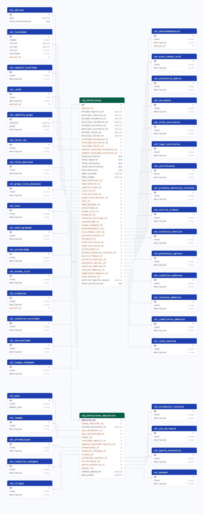

# defunciones_inegi

## Descripción general

Defunciones registradas en México publicadas por INEGI en el programa **EDR** (Estadísticas de Defunciones Registradas). Cada fila es una defunción, con su causa (CIE-10 y clasificaciones agregadas), características demográficas y socioeconómicas de la persona fallecida, circunstancias de la muerte y su geografía en cuatro ámbitos: registro, residencia habitual, ocurrencia y ocurrencia de la lesión. Se carga el país completo desde la edición **2017**, la primera con la estructura de datos abiertos actual.

No confundir con el pipeline `defunciones`, que toma los mismos hechos de la **DGIS (Secretaría de Salud)** con un esquema distinto.

## Fuente general

https://www.inegi.org.mx/programas/edr/

## Fuente específica

INEGI cambia el nombre y hasta la carpeta del archivo entre ediciones: renombró
el ZIP tres veces dentro de `defunciones/{year}/` y publicó 2025 fuera de esa
carpeta. Por eso las URLs **no se adivinan**: se leen del mismo catálogo con el
que la página arma la pestaña
[Datos abiertos](https://www.inegi.org.mx/programas/edr/#datos_abiertos).

**1. Catálogo de descarga masiva (fuente primaria)** — `SOURCE_CATALOG_URL`

```shell
https://www.inegi.org.mx/app/api/descarga/componente/descargamasiva/lista/archivoscompaginacion?...&idBiinegi=3358&datosAbiertos=1&tipodocto=12
```

Devuelve un registro por edición. Se toman los de `tipoInformacion = "Datos abiertos"`
con formato `_csv.zip`, y la URL se arma como
`SOURCE_CONTENT_URL` + `pathLogico` + `_csv.zip`:

```json
{
  "anioInformacion": "|2025",
  "formato": "_csv.zip&29.2  MB&CON_ESTANDAR|",
  "pathLogico": "/programas/edr/datosabiertos/conjunto_de_datos_edr2025",
  "tipoInformacion": "Datos abiertos"
}
```

**2. Plantillas (respaldo)** — `SOURCE_BASE_URL` + `SOURCE_URL_TEMPLATES`

Si el catálogo falla (red, HTTP, JSON inválido, lista vacía) o no lista un año,
se prueban las plantillas en orden, como antes del catálogo:

```shell
https://www.inegi.org.mx/contenidos/programas/edr/datosabiertos/defunciones/{year}/{archivo}
```

| Edición | Ruta publicada | Ejemplo |
|---|---|---|
| 2025 | `datosabiertos/conjunto_de_datos_edr{year}_csv.zip` (sólo vía catálogo) | [2025](https://www.inegi.org.mx/contenidos/programas/edr/datosabiertos/conjunto_de_datos_edr2025_csv.zip) |
| 2024 | `defunciones/{year}/conjunto_de_datos_edr{year}_csv.zip` | [2024](https://www.inegi.org.mx/contenidos/programas/edr/datosabiertos/defunciones/2024/conjunto_de_datos_edr2024_csv.zip) |
| 2018 – 2023 | `defunciones/{year}/conjunto_de_datos_defunciones_registradas_{year}_csv.zip` | [2023](https://www.inegi.org.mx/contenidos/programas/edr/datosabiertos/defunciones/2023/conjunto_de_datos_defunciones_registradas_2023_csv.zip) |
| 2017 | `defunciones/{year}/conjunto_de_datos_defunciones_generales_{year}_csv.zip` | [2017](https://www.inegi.org.mx/contenidos/programas/edr/datosabiertos/defunciones/2017/conjunto_de_datos_defunciones_generales_2017_csv.zip) |

El log indica de dónde salió cada URL: `[source] 2025: https://… (catalogo)` o `(plantilla)`.

**El código HTTP no basta para saber si un año existe:** INEGI responde `200` con
una página de error (~2 KB de `text/html`) cuando no hay edición. Por eso toda URL,
venga del catálogo o de una plantilla, se valida leyendo sólo sus primeros bytes:
un ZIP real empieza con `PK`. No se baja el archivo para descubrirlo.

## Características de los datos

| Característica | Valor |
|---|---|
| Última fecha disponible | `2025` |
| Frecuencia de actualización | Anual |
| Desagregación | Localidad |
| ¿Tiene update? | Sí |
| Update | Automático |

## Diagrama de entidad relación



Se genera con un layout de peine, no con `scripts/generate_erds.py`:

```shell
python scripts/generate_erd_comb.py defunciones_inegi
```

Los layouts de `sqlalchemy-erd` (`star`, `force`, `layered`) encimaban las cajas
porque una tabla de hechos referencia ~30 catálogos casi idénticos. El peine
ordena cada catálogo a la altura de su FK, así las aristas no se cruzan y son
ortogonales. Las tablas de hechos (`stg_*`) van en verde y los catálogos en azul,
con los colores de los temas de la propia librería.

## Diccionario de variables

### stg_defunciones

Variables presentes en **todas** las ediciones desde 2017.

| variable | descripción |
|---|---|
| `id` | Identificador único de la fila (surrogate) |
| `edicion_id` | Edición EDR de la que proviene la fila |
| `entidad_*_id` / `municipio_*_id` | Clave INEGI del ámbito (registro, residencia, ocurrencia, lesión). Se une contra `cvegeo_states.cve_ent` y `cvegeo_municipalities` (`cve_ent` + `cve_mun`) por FDW |
| `localidad_*_id` | Localidad del ámbito, contra `cat_localidad` |
| `tamanio_localidad_*_id` | Tamaño de localidad del ámbito |
| `fecha_ocurrencia` | Fecha de ocurrencia, armada con `dia_ocurr + mes_ocurr + anio_ocur`. Nula si falta algún componente o la fecha no existe en el calendario |
| `dia_ocurrencia` / `mes_ocurrencia` / `anio_ocurrencia` | Componentes de la fecha de ocurrencia, cada uno nulo sólo si su propio valor viene como no especificado (`99` día y mes, `9999` año). Un año conocido se conserva aunque falten el día o el mes |
| `fecha_registro` / `fecha_nacimiento` / `fecha_certificacion` | Ídem, con sus propios componentes |
| `dia_*` / `mes_*` / `anio_*` de registro, nacimiento y certificación | Misma semántica que los de ocurrencia |
| `hora_defuncion` | Hora de la defunción, armada con `horas + minutos` |
| `edad_cantidad` / `edad_unidad` | Edad descompuesta del código INEGI: unidad `1` horas, `2` días, `3` meses, `4` años |
| `causa_defuncion_id` | Causa de la defunción (CIE-10, lista detallada) |
| `causa_materna_id` | Causa en defunciones maternas (CIE-10) |
| `capitulo_grupo_id` | Capítulo y grupo de causas detalladas CIE |
| `lista_cie_id` | Lista de tabulación 1 para mortalidad de la CIE |
| `lista_mexicana_id` / `grupo_lista_mexicana_id` | Causa según la lista mexicana y su grupo |
| `sexo_id`, `edad_agrupada_id`, `escolaridad_id`, `estado_civil_id` | Características demográficas |
| `ocupacion_id`, `condicion_actividad_id`, `derechohabiencia_id` | Características socioeconómicas |
| `nacionalidad_id`, `lengua_indigena_id`, `area_urbana_rural_id` | Adscripción y contexto |
| `asistencia_medica_id`, `necropsia_id`, `sitio_ocurrencia_id`, `certificante_id` | Circunstancias de la atención |
| `presunta_defuncion_violenta_id`, `lugar_ocurrencia_id`, `ocurrio_trabajo_id`, `violencia_familiar_id`, `parentesco_agresor_id` | Circunstancias de muertes violentas |
| `condicion_embarazo_id`, `relacion_embarazo_id`, `complicaron_embarazo_id`, `razon_materna_id` | Mortalidad materna |
| `distrito_registro_oaxaca_id` | Distrito de registro de Oaxaca, contra `cat_distrito_oaxaca`. Nulo fuera de esa entidad, donde la fuente trae el centinela `999` |
| `fecha_actualizacion` | Fecha en que el pipeline cargó la fila |

### stg_defunciones_ampliacion

Variables que INEGI incorporó en **2022**. Relación 1:1 con `stg_defunciones` por `defuncion_id`; no tiene filas para ediciones anteriores.

| variable | descripción |
|---|---|
| `defuncion_id` | Defunción a la que amplía esta fila |
| `codigo_adicional_id` | Código adicional CIE |
| `entidad_nacimiento_id` | Entidad de nacimiento (claves `001`-`032` de `ent_nac`) |
| `pais_nacimiento_id` | País de nacimiento (claves `101`-`535` de `ent_nac`) |
| `pais_nacionalidad_id` | Nacionalidad extranjera |
| `lengua_id` | Clave de la lengua indígena |
| `localidad_registro_id` / `tamanio_localidad_registro_id` | Localidad y tamaño de localidad de registro |
| `afromexicano_id`, `condicion_indigena_id` | Autoadscripción |
| `cirugia_id`, `accidental_violenta_id`, `uso_necropsia_id`, `muerte_encefalica_id`, `donador_id` | Circunstancias de la atención |
| `semanas_gestacion` | Semanas de gestación |
| `peso_gramos` | Peso en gramos de fallecidos con menos de 28 días |

## Migraciones

| migración | descripción |
|---|---|
| `V1__foreign_tables.sql` | Extensión `postgres_fdw` y foreign tables `cvegeo_states` / `cvegeo_municipalities` |
| `V2__catalogs_defunciones_inegi.sql` | Crea los 40 catálogos (codificados, versionados, estructurados y edición) |
| `V3__tables_defunciones_inegi.sql` | Crea `stg_defunciones` y `stg_defunciones_ampliacion` con sus FK e índices |
| `V4__comments_defunciones_inegi.sql` | `COMMENT ON` de tablas y columnas, tomados del diccionario de datos oficial |
| `V5__views_defunciones_inegi.sql` | Vistas `vw_defunciones`, `vw_defunciones_ampliacion` y sus variantes `_jalisco`. Convención: `X_id` es la clave y `X` la descripción |
| `V7__comments_views_defunciones_inegi.sql` | `COMMENT ON` de las cuatro vistas y sus columnas (van aparte porque `V4` corre antes de que las vistas existan) |
| `V9__distrito_registro_oaxaca.sql` | Crea `cat_distrito_oaxaca`, cambia `distrito_registro_oaxaca` por su FK y recrea las vistas de defunciones para exponer el nombre del distrito |
| `V8__date_components_defunciones_inegi.sql` | Agrega `dia_*`, `mes_*` y `anio_*` de las cuatro fechas a `stg_defunciones` con su índice en `anio_ocurrencia`, los expone en `vw_defunciones` y `vw_defunciones_jalisco`, y escribe sus `COMMENT ON` |
| `V6__sentence_case_descripciones.sql` | Pasa a mayúscula inicial las descripciones de `cat_lista_cie` y `cat_grupo_lista_mexicana`, preservando siglas y nombres propios |

## Variables de entorno

| variable | descripción |
|---|---|
| `DB_*` | Conexión a la base `defunciones_inegi` |
| `SOURCE_CATALOG_URL` | Catálogo de descarga masiva de INEGI (`idBiinegi=3358`); fuente primaria de las URLs |
| `SOURCE_CONTENT_URL` | Prefijo que se antepone al `pathLogico` del catálogo (por defecto `https://www.inegi.org.mx/contenidos`) |
| `CATALOG_TIMEOUT` | Segundos de espera por el catálogo (por defecto `60`) |
| `SOURCE_BASE_URL` | Raíz de los datos abiertos del programa EDR; respaldo cuando el catálogo no trae la edición |
| `SOURCE_URL_TEMPLATES` | Plantillas del archivo por año, separadas por coma y probadas en ese orden (respaldo) |
| `BACKFILL_MIN_YEAR` | Primera edición a descubrir y cargar (por defecto `2017`) |
| `DOWNLOAD_TIMEOUT` | Segundos de espera por descarga (por defecto `600`) |
| `CHUNK_SIZE` | Filas por lote al leer el CSV de hechos y al hacer bulk insert |

## Notas metodológicas

### Extract

Consulta una vez el catálogo de descarga masiva y, año por año desde `BACKFILL_MIN_YEAR` (o desde la edición siguiente a la última cargada, en update), prueba primero la URL del catálogo y luego las plantillas. **El código HTTP no basta**: INEGI responde `200` con la página de error cuando el año no existe, así que cada candidata se valida leyendo sólo su firma de ZIP (`PK`). Deja el ZIP en disco (lo reusa entre corridas) y extrae sólo los catálogos; el CSV de hechos pesa cientos de MB y lo recorre el transform.

### Transform

Consolida los catálogos de todas las ediciones y normaliza los hechos por lotes:

- **Fechas**: `dia + mes + anio` se guardan en tres columnas normalizadas **y** se colapsan en un `DATE`. Un centinela (`99` día y mes, `9999` año) anula sólo su propio componente; la fecha completa además queda nula si alguno falta o si el calendario no admite la combinación (31 de febrero). Así un año conocido sigue sirviendo para agregados anuales aunque INEGI no especifique el día. `horas + minutos` se colapsan en un `TIME`.
- **Edad**: el código de cuatro dígitos se parte en `edad_unidad` y `edad_cantidad`.
- **Lugar de nacimiento**: `ent_nac` mezcla entidades y países en un solo campo; se separa en dos columnas mutuamente excluyentes.
- **Distritos de Oaxaca**: los 30 distritos (`901-930`) viajan dentro del catálogo de localidades, como filas con `cve_loc` en cero. No son localidades, así que `localidad_records` las descarta y `distrito_oaxaca_records` las rescata para `cat_distrito_oaxaca`. Es el único nivel geográfico intermedio del país y sólo aplica a esa entidad: `999` marca los registros del resto del país y se guarda como `NULL`.
- **Claves alfanuméricas**: se canonizan quitando el cero a la izquierda. `grupo_lista_mexicana` publica el catálogo como `1` y los hechos como `01` en 2017-2021; sin esto el join se pierde en silencio.

### Load

Inserta primero los catálogos (`ON CONFLICT DO NOTHING`), construye los mapeos clave → `id` desde la base y luego carga los hechos edición por edición con `bulk_insert`. Los `id` de `stg_defunciones` se asignan explícitamente para poder construir la fila 1:1 de la ampliación sin un round-trip, y al final se llama `sync_id_sequence`.

La carga es **idempotente por edición**:

- Load sólo procesa las ediciones que Transform devolvió en la misma corrida; no lista `data/transform/defunciones_inegi/hechos/`. Si Transform no produjo ediciones, Load no toca la base ni refresca vistas.
- Antes de insertar una edición se borran sus filas de `stg_defunciones_ampliacion` y `stg_defunciones` (en ese orden, por la FK), dentro de la misma transacción.
- Transform limpia los `.pkl` de hechos al empezar y Load borra los que ya cargó, para que ninguna corrida posterior vea artefactos viejos.

Al terminar se refrescan `vm_mortalidad_materna_geo`, `vm_mortalidad_infantil_geo` y `vm_mortalidad_adulta_geo`.

## Ejecución

**Bootstrap** (carga inicial de todas las ediciones):

```shell
just create-db defunciones_inegi
just flyway-migrate defunciones_inegi
python dags/etl_defunciones_inegi.py
```

**Update** (anual, DAG `etl_defunciones_inegi_update`, schedule `0 18 1 12 *`):

Arranca en la edición siguiente a la última cargada, así que no vuelve a descargar lo que ya está en la base.

**Recarga histórica** (necesaria una sola vez, para poblar los componentes de fecha):

Las ediciones cargadas antes de `V8` tienen `dia_*`, `mes_*` y `anio_*` en `NULL`, y las anteriores a `V9` no tienen resuelto el distrito de Oaxaca: la versión anterior del transform descartaba esos componentes después de armar la fecha, así que la migración sola no puede reconstruirlos. Hay que reprocesar desde los archivos EDR de origen:

```shell
just flyway-reset defunciones_inegi
python dags/etl_defunciones_inegi.py
```

Los ZIP ya descargados se reusan, así que la recarga cuesta transform y load, no la descarga. Como cada edición se reemplaza completa, correr el bootstrap sobre datos existentes ya no los duplica; partir del schema vacío sólo es necesario cuando cambian las migraciones.

## Notas adicionales

- **Cambio de metodología en 2022.** Las ediciones 2017-2021 traen 59 columnas y las de 2022 en adelante 73/74. Por eso las 16 variables nuevas viven en `stg_defunciones_ampliacion` en vez de dejar nulos en cinco ediciones. `presunto` (2017-2021) y `tipo_defun` (2022+) son la misma variable renombrada por INEGI, así que va en la tabla base.
- **`vio_fami` falta sólo en 2022**, pero existe en 2017-2021 y 2023-2024. Es un hueco de un año, no un cambio de metodología: la columna vive en `stg_defunciones` y queda nula para esa edición.
- **La edición 2017 nombra los catálogos con prefijo `de`** (`desexo.csv`, `detamloc.csv`) y codifica capítulo y grupo en una sola clave (`101` = capítulo 1, grupo 1). De 2019 en adelante usa la nomenclatura moderna.
- **Entidades y municipios no se copian.** Viven en la base `cvegeo` y se consultan por FDW, según `docs/estandares_datos.md` §2. `cat_localidad` guarda sólo el nivel localidad, que `cvegeo` no cubre. Las claves se conservan en `stg_` porque `cvegeo` desconoce los centinelas (`88` no aplica, `99` no especificada, `33` Estados Unidos).
- **Convención de nombres en las vistas.** `X_id` es la clave (código INEGI o clave del catálogo) y `X` la descripción legible: `entidad_registro_id` = `14`, `entidad_registro` = `Jalisco`.
- **2012 – 2016 no se cargan.** El catálogo sí las lista, pero en otra carpeta y con otro archivo (`defunciones/{year}/defunciones_base_datos_{year}_csv.zip`) cuya estructura este pipeline no ha validado. `BACKFILL_MIN_YEAR=2017` las deja fuera; bajar ese valor requiere revisar primero sus columnas y catálogos.

## Sugerencia de vistas materializadas

Este pipeline entrega **sólo vistas de detalle**. Los agregados analíticos se dejan
deliberadamente fuera: son decisiones del área de análisis, no del ETL.

Las cuatro vistas que sí se entregan (`vw_defunciones`, `vw_defunciones_jalisco`,
`vw_defunciones_ampliacion`, `vw_defunciones_ampliacion_jalisco`) son vistas
normales y **siempre reflejan la última carga**: no hay que refrescarlas. Se
consultan con filtros (`WHERE anio_edicion = 2024 AND entidad_residencia_id = 14`)
y el filtro se empuja hasta `stg_defunciones`, que tiene índices en `edicion_id`
y en las cuatro columnas de entidad.

Para agregados conviene lo contrario: **vistas materializadas** (`mv_*`), porque su
`GROUP BY` se ejecuta antes del `WHERE` del consumidor y recorrería los ~6.4M
registros en cada consulta. El precedente en el proyecto es
`migrations/enoe_microdatos/sql/V6__mv_enoe_tasas.sql`.

### Agregados propuestos

| Vista sugerida | Grano | Para qué |
|---|---|---|
| `mv_defunciones_municipio` | municipio residencia × año × sexo × edad agrupada | Base de tasas de mortalidad, mapas y pirámides |
| `mv_defunciones_principales_causas` | municipio × año × `lista_cie` × sexo | Tablas de principales causas de muerte |
| `mv_defunciones_violentas` | municipio × año × sexo × `presunta_defuncion_violenta` | Homicidios, suicidios y accidentes, con `violencia_familiar` y `parentesco_agresor` |
| `mv_mortalidad_infantil` | municipio × año × sexo × causa | Numerador de la tasa de mortalidad infantil (`cat_edad_agrupada.clave = 1`) |
| `mv_mortalidad_materna` | municipio × año × causa | Razón de mortalidad materna (`cat_razon_materna.clave = 1`) |
| `mv_defunciones_entidad` | entidad residencia × año × sexo × edad agrupada | Comparativos nacionales y ranking de Jalisco |
| `mv_defunciones_residencia_ocurrencia` | residencia × ocurrencia × año | Cuántas defunciones ocurren fuera de la entidad de residencia |

Las dos últimas sólo son posibles en este pipeline: el de DGIS (`defunciones`) está
acotado a residentes de Jalisco.

### Consideraciones para quien las implemente

- **Refresco.** Una `mv_*` no se actualiza sola. Agregar
  `REFRESH MATERIALIZED VIEW` al `finalization` de `DefuncionesInegiLoad`, o
  programarlo después del DAG.
- **Índices.** Indexar al menos `(anio, entidad_residencia_id)`; sin eso se pierde
  buena parte de la ventaja.
- **Geografía por FDW.** Un `JOIN` entre una tabla local y una foránea no se puede
  empujar al servidor remoto: PostgreSQL trae las filas de `cvegeo_municipalities`
  y hace el join localmente. Medido con `EXPLAIN ANALYZE`, ese `Foreign Scan` cuesta
  ~1.4 s (2,475 filas) más ~0.4 s de planeación. Es un costo **fijo por consulta**,
  no proporcional al volumen: pesa en consultas chicas y se vuelve marginal en las
  grandes, donde domina el escaneo de `stg_defunciones`.
- **Son conteos, no tasas.** El denominador (población o nacimientos) vive en las
  bases `conapo` y `censo_poblacion`. Lo natural es calcular la tasa en
  `core/indicadores`, que ya está pensado para cruzar pipelines.
- **Comparabilidad entre ediciones.** Cualquier agregado que use variables de
  `stg_defunciones_ampliacion` sólo tiene datos de 2022 en adelante.
