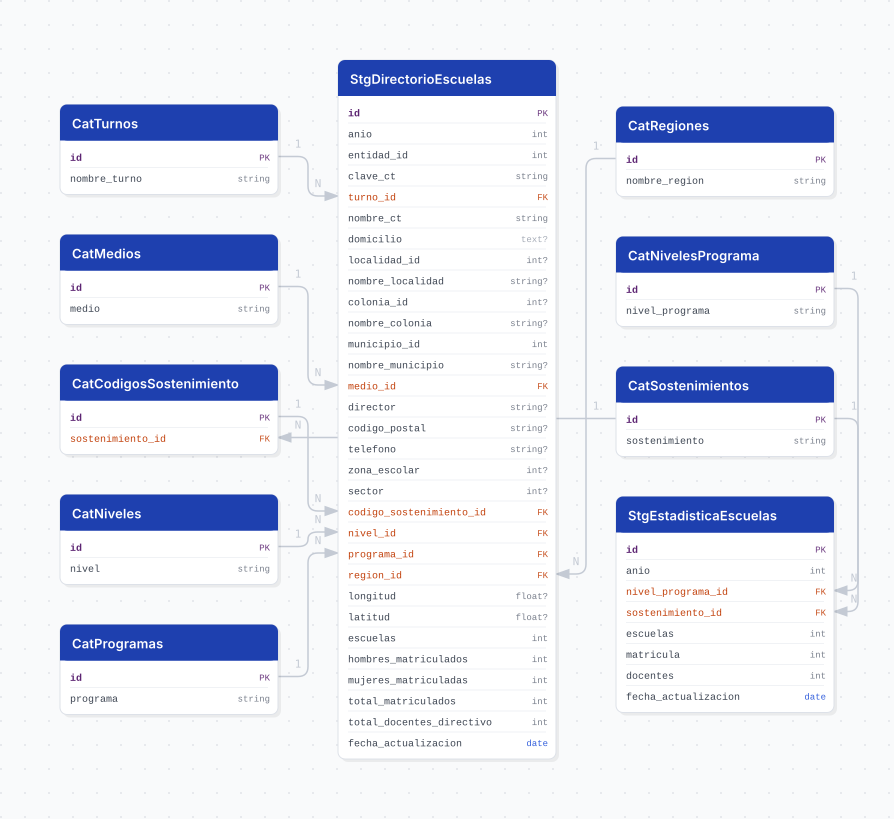

# escuelas

## Descripción general

Directorio de centros de trabajo educativos de Jalisco y estadística agregada de escuelas, matrícula y docentes por nivel/programa y sostenimiento. El directorio incluye ubicación, contacto, matrícula y docentes por centro de trabajo, turno, nivel y programa. Cada carga se asigna al año configurado en `SOURCE_YEAR`.

## Fuente general

Carpeta compartida de Google Drive, configurada con `GDRIVE_FOLDER_ID`. No tiene un sitio público.

## Fuente específica

```shell
GDRIVE_FOLDER_ID=<ID de la carpeta>
DIRECTORIO_FILENAME=directorio_escuelas.csv
ESTADISTICA_FILENAME=estadistica_escuelas.csv
```

## Características de los datos

| Característica | Valor |
|---|---|
| Última fecha disponible | `2026` (valor por defecto de `SOURCE_YEAR`) |
| Frecuencia de actualización | Bajo demanda |
| Desagregación | Centro de trabajo (directorio) y Estatal (estadística) |
| ¿Tiene update? | No |
| Update | N/A |

## Diagrama de entidad relación



## Diccionario de variables

### stg_directorio_escuelas

Una fila por `anio`, `clave_ct`, `turno_id`, `nivel_id` y `programa_id`.

| variable | descripción |
|---|---|
| `anio` | Año asignado a la carga (`SOURCE_YEAR`) |
| `entidad_id` | Clave de entidad; siempre `14` (Jalisco) |
| `clave_ct` | Clave del centro de trabajo |
| `municipio_id` | Clave de municipio dentro de la entidad (`cve_mun`) |
| `codigo_sostenimiento_id` | Código de sostenimiento de la fuente; `cat_codigos_sostenimiento` lo vincula a `cat_sostenimientos` |
| `zona_escolar` | Zona escolar del centro de trabajo |
| `sector` | Sector educativo; el `0` de la fuente se guarda como `NULL` |
| `escuelas` | Conteo de escuelas reportado por la fuente para la fila |
| `total_docentes_directivo` | Total de docentes y personal directivo |
| `fecha_actualizacion` | Fecha en que se ejecutó la transformación |

### stg_estadistica_escuelas

Una fila por `anio`, `nivel_programa_id` y `sostenimiento_id`.

| variable | descripción |
|---|---|
| `anio` | Año asignado a la carga (`SOURCE_YEAR`) |
| `nivel_programa_id` | Nivel/programa usado en la estadística; es un catálogo distinto de `cat_niveles` y `cat_programas` |
| `escuelas` | Total de escuelas de la combinación |
| `matricula` | Total de alumnos de la combinación |
| `docentes` | Total de docentes de la combinación |
| `fecha_actualizacion` | Fecha en que se ejecutó la transformación |

## Migraciones

| migración | descripción |
|---|---|
| `V1__foreign_tables.sql` | Tablas foráneas de entidades y municipios desde `cvegeo` |
| `V2__catalogs_escuelas.sql` | Catálogos del directorio y de la estadística |
| `V3__tables_escuelas.sql` | Tablas `stg_directorio_escuelas` y `stg_estadistica_escuelas` |
| `V4__views_escuelas.sql` | Vistas `v_directorio_escuelas` y `v_estadistica_escuelas` |
| `V5__comments_escuelas.sql` | Comentarios de tablas y columnas |

## Vistas

| vista | alcance |
|---|---|
| `v_directorio_escuelas` | Directorio con catálogos resueltos; entidad y municipio desde `cvegeo` |
| `v_estadistica_escuelas` | Estadística con nivel/programa y sostenimiento resueltos |

## Variables de entorno

| variable | descripción |
|---|---|
| `LOG_LEVEL` | Nivel de logging del pipeline |
| `DB_USER` | Usuario de PostgreSQL |
| `DB_PASSWORD` | Contraseña de PostgreSQL |
| `DB_HOST` | Host de PostgreSQL |
| `DB_PORT` | Puerto de PostgreSQL |
| `DB_NAME` | Base de datos destino |
| `SOURCE_YEAR` | Año asignado a la carga |
| `DIRECTORIO_FILENAME` | Nombre del CSV del directorio |
| `ESTADISTICA_FILENAME` | Nombre del CSV de estadística |
| `GDRIVE_FOLDER_ID` | ID de la carpeta de Google Drive |
| `GDRIVE_CLIENT_EMAIL` | Correo de la cuenta de servicio |
| `GDRIVE_PRIVATE_KEY` | Llave privada de la cuenta de servicio |

## Notas metodológicas

### Extract

Descarga la carpeta de Google Drive con una cuenta de servicio, localiza los dos CSV por nombre y los lee con codificación `utf-8-sig`.

### Transform

Normaliza encabezados, limpia valores nulos textuales y convierte tipos numéricos. Guarda como `NULL` los ceros de `telefono`, `codigo_postal`, `colonia_id`, `nombre_colonia` y `sector`. Agrega `anio`, `fecha_actualizacion` y, en el directorio, `entidad_id`. Construye los catálogos a partir de los valores de ambos archivos.

### Load

Inserta los catálogos con `insert_records` y resuelve sus claves foráneas. Después borra las filas de `SOURCE_YEAR` en las dos tablas staging y las vuelve a insertar con `bulk_insert`, por lo que los años anteriores se conservan.

## Ejecución

**Bootstrap** (bajo demanda, DAG `etl_escuelas_bootstrap`):

```shell
just flyway-config escuelas
just create-db escuelas
just flyway-migrate escuelas
python dags/etl_escuelas.py
```

Antes de ejecutar, comparte la carpeta de Google Drive con la cuenta de servicio y crea `core/pipelines/escuelas/.env` a partir de `.env.example`. `just create-db` solo hace falta si la base aún no existe.

**Update**: no está implementado. Para cargar un año nuevo, cambia `SOURCE_YEAR` y ejecuta de nuevo el bootstrap.
